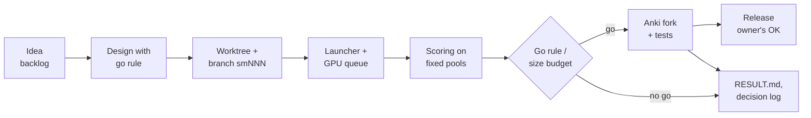

# anki-rwkv

Training and compression research for the RWKV spaced-repetition model used in Anki. This repository contains the RWKV model, preprocessing, CUDA training kernel, trainer, evaluation, and recurrent inference code from [srs-benchmark](https://github.com/open-spaced-repetition/srs-benchmark), with the small supporting subset needed to run that pipeline independently.

The starting point is the original 2,762,884-parameter architecture. Expertium's historical 192,800-parameter iter36 architecture is included separately for matched CPU and CUDA trials. The default baseline remains unchanged; compressed-state deployment is documented as research and is not enabled in these trials.

Today most of the work happens in "the factory" described below: a daily loop that designs, trains, scores and packages families of RWKV memory models for the Anki fork. The sections after it are the project's earlier history (the R01 speed campaign and the first trials) and the reference procedures.

## The factory

The factory is the routine that turns an idea into a tested model or format that the Anki fork can ship. It runs on one desktop GPU (an RTX 5080) shared through a queue. An AI main session coordinates the work, short-lived agents run single steps, and the repository owner decides releases and real trade-offs. The live state is on the [factory page](https://jschoreels.github.io/anki-rwkv/factory.html).

### What it produces

- **A model family in three sizes.** Big uses the fork's original 2,762,884-parameter architecture, Small has 331,511 parameters and the six-layer Tiny has 185,057.
- **Two models per size.** The two-head model predicts both the recall curve over time (used by the RWKV-Curve scheduler) and the instant answer (used by RWKV-Instant). The Instant-Only model is trained with its curve head switched off: it is a little better on the instant answer, and its curve head must never be used. The fork runs each size only with that size's own models, and an option lets it run the two-head model alone.
- **Compact card-state formats.** The model keeps a recurrent state for every card and note, so state size matters as much as weight size for a large collection. The reference format is int8 card rows with compact notes. T24 is a low-rank format (rank 2 below 16 answers, rank 4 after, int8 factors), and T24 with 6-bit factors goes further. On 2026-11-24 the owner chose T24 with 6-bit factors for Big and Small (84.6% and 71.4% fewer bytes than int8) and plain T24 for Tiny, because of a long-card warning.
- **Family releases.** A family release is a tagged GitHub release with the weights of every model, its integration notes, test vectors and [WEIGHTS-NOTICE.md](WEIGHTS-NOTICE.md), matched to the Anki fork version that runs them. The latest is [`rwkv-family-2026-11-13`](https://github.com/JSchoreels/anki-rwkv/releases/tag/rwkv-family-2026-11-13), packaged by the family release step (SM108). The next family is being prepared with these candidates: Big two-head (SM91s2), Big Instant-Only (SM99), Small two-head (SM118), Small Instant-Only (SM113), and the six-layer Tiny two-head and Instant-Only models (SM130).

### How one experiment moves through the factory



1. **Idea.** Ideas wait in the backlog of the factory page and in [docs/ACCURACY_IDEAS.md](docs/ACCURACY_IDEAS.md). Some come from outside research and papers ([docs/IDEA_SCOUTING.md](docs/IDEA_SCOUTING.md)); those are treated as pointers, and this repository's own training and scoring pipeline stays the reference.
2. **Pre-registered design.** Each experiment gets an ID (SMnnn) and a `design.md` that is committed before any result exists. It states the question, the models, the evaluation pool and the go rule, so the verdict cannot be tuned after the fact.
3. **One worktree and one branch per experiment.** The experiment lives in its own git worktree on branch `smNNN`, with its files under `artifacts/small-model/smNNN/` on that branch. More than a hundred such branches are on the remote; only a few older folders are on `main`.
4. **Launcher and GPU queue.** A launcher script (`launch-smNNN-*.sh`) typically checks for a clean tree, runs a small smoke check and then submits each step as a ticket to [`scripts/r01_queue.py`](scripts/r01_queue.py). The queue runs tickets in order per shared resource (the GPU, the training sources), so sessions never collide. Quiet windows in `artifacts/coordination/queue/quiet.json` hold new GPU tickets back, for example during speed measurements. A `STOP` file stops a launcher before its next ticket, and a stopped launcher can be resumed without redoing finished work.
5. **Scoring on fixed evaluation pools.** The standard readout is the 732-user set (722 to 723 users after the scoring rules, never seen by the big model). Decisive checks use all 1,500 validation users. Both heads are scored on show-time inputs, the inputs the fork has when a card is shown. Results are given as the LogLoss change in % against the big model (1 leak-free epoch) (SM72 big), with int8 weights and int8 state.
6. **The go rule.** A change is compared per user against its control, with a 95% paired user-bootstrap confidence interval. It is a go only when the upper end of that interval is below 0 and the gain is at least 0.05%. For example, output-aware truncation (SM158) gained 0.008% to 0.027% on the instant heads and was not adopted.
7. **Size budgets.** Smaller models and state formats are judged by their total cost against the Big model at int8: Small may lose at most 0.5% and Tiny at most 1.0%, and Big may lose at most 0.15% against its own int8, each on the upper end of the confidence interval and for each head. Long-card and per-card checks are warnings, not gates.
8. **RESULT.md and HANDOFF.md.** Every experiment folder ends with a `RESULT.md` (question, rules, verdict, numbers). While a job runs, its `HANDOFF.md` records the job IDs, output paths, how to check, stop and resume it, and the exact follow-up commands.
9. **Factory page.** [`pages/factory.html`](pages/factory.html) shows what runs now, the timetable, the backlog and every result. It is built from the hand-edited [`pages/data/factory-curated.json`](pages/data/factory-curated.json) plus the live queue by [`scripts/publish_factory_page.py`](scripts/publish_factory_page.py), which a loop runs every 5 minutes (details in [pages/README.md](pages/README.md)).
10. **Decision log.** Every decision is logged in [docs/decisions/DECISIONS.md](docs/decisions/DECISIONS.md) (one line each) and [docs/decisions/DECISIONS-full.md](docs/decisions/DECISIONS-full.md) (why, evidence, scope and how to undo it). Each entry says whether the owner decided or an agent took an obvious call alone.
11. **Integration into the Anki fork.** Adopted models and formats are ported to the fork's Rust runtime on a fork branch, checked against this repository's outputs (for example the fork input parity check (SM161), which found a Learning-card interval bug before the release) and run through the fork's tests. Finished, tested fork work is merged into fork `main`.
12. **Packaging and release.** Release packages, tags, Hugging Face uploads and the fork release build all need the owner's explicit OK.

### Who does what

- **The main session** (an AI coding agent) keeps the plan, reads out finished work, updates the factory page and the decision log, and starts the next backlog item.
- **Short-lived agents** each run one step (a design, a launch, a read-out, a fork port) and stop. Before a long wait they write a `HANDOFF.md`, and a fresh agent picks up from that file when the results land, instead of one agent waiting for hours.
- **GPU jobs run detached** in hidden processes, so they keep running when an agent stops.
- **The hourly idle check** [`scripts/factory_idle_check.py`](scripts/factory_idle_check.py) prints BUSY, QUIET or IDLE from the queue, the GPU load, live launcher processes and the quiet windows. IDLE means nothing runs and no quiet window explains it, so the main session reads out what finished and starts the next item. It exists because a dead watcher once left the GPU idle for about eight hours.
- **The owner** decides releases, installs, anything touching a private Anki profile, and any real trade-off between accuracy and size or speed beyond the agreed budgets. Obvious calls are taken by the agents and logged for review.

### Where to look

- [Factory page](https://jschoreels.github.io/anki-rwkv/factory.html): what runs now, the plan, the backlog and every result.
- [Decision log](docs/decisions/DECISIONS.md) and [complete decision log](docs/decisions/DECISIONS-full.md).
- [docs/SMALL_MODEL_INTEGRATION.md](docs/SMALL_MODEL_INTEGRATION.md): integration manual for a small model package (file formats, inputs, forward pass, state).
- [docs/ACCURACY_LOOP.md](docs/ACCURACY_LOOP.md): the paired, seeded comparison method the go rules grew out of; ideas in [docs/ACCURACY_IDEAS.md](docs/ACCURACY_IDEAS.md), results in [docs/ACCURACY_LOG.md](docs/ACCURACY_LOG.md).
- [docs/COMPRESSION.md](docs/COMPRESSION.md) and [docs/COMPRESSION_INTEGRATION.md](docs/COMPRESSION_INTEGRATION.md): state and weight compression.
- [docs/GPU_TRAINING.md](docs/GPU_TRAINING.md) and [docs/R01_PARALLEL_SESSIONS.md](docs/R01_PARALLEL_SESSIONS.md): GPU setup, and the queue claims and session rules.
- `artifacts/small-model/`: experiment folders (each experiment's full folder is on its own `smNNN` branch).

## Start here

- [The factory](#the-factory): what the project produces today and how one experiment moves from idea to release.
- [Factory page](https://jschoreels.github.io/anki-rwkv/factory.html): live status, plan, backlog and results.
- [Decision log](docs/decisions/DECISIONS.md): every decision, newest first, with the [complete version](docs/decisions/DECISIONS-full.md).
- [Documentation guide](docs/README.md): choose the overview or procedure you need.
- [Artifact guide](artifacts/README.md): current results and short folder guides.

## R01 GPU speedup dashboard

**[Open the interactive dashboard](https://jschoreels.github.io/anki-rwkv/campaign.html)** - Expertium training throughput went from **30,005 reviews/s** (original baseline) to **200,356 reviews/s** (accepted in iteration 0080), a **x6.68** speedup with bitwise-identical results.

The dashboard plots the accepted throughput over every R01 iteration with each candidate optimisation coloured by decision, the cumulative speedup, and the replicated-block gains with lower confidence bounds. A milestone timeline explains what each major step changed (sort-free exact kernels, deferred host reads, native C++ launch path, core pinning, process QoS) and why it mattered. Regenerate the data with `scripts/build_r01_pages_data.py`; see [pages/README.md](pages/README.md). The [site home](https://jschoreels.github.io/anki-rwkv/) explains how RWKV reads a review history with interactive examples, and the [architecture page](https://jschoreels.github.io/anki-rwkv/models.html) compares the Alex and Expertium models block by block.

R01 and GPU trial defaults now permit a 95% Torch GPU allocation budget. R01 uses a 2% measured speed-gain gate for exact update, weight, input and score parity, and a 5% target for other adaptations; [the ledger](docs/GPU_OPTIMIZATIONS.md) records the current accepted configuration and per-trial limits.

## Local GPU results — 2026-10-11

GPU training is working on the Windows **RTX 5080**. These runs perform forward passes, loss computation, backpropagation, gradient clipping, and AdamW weight updates; the speed figures measure **training**, not inference. The default model completed one pass over the **complete histories of users 1–100: 5,226,500 reviews and 1,029 optimizer updates**. Coverage, finite losses/gradients, and CPU recurrent checkpoint loading were verified.

The separate throughput comparison measured:

| Model | Parameters | Chunks / CPU workers | Reviews/s |
| --- | ---: | --- | ---: |
| Default | 2,762,884 | 128 / 4 | **41,240** |
| Expertium iter36, matched settings | 192,800 | 128 / 4 | **59,710** |
| Expertium iter36, tuned | 192,800 | 256 / 6 | **76,002** |

All three use BF16 computation with float32 master weights and AdamW state. Each chunk contains 128 raw reviews. Rates include CPU preparation waits, transfers, and training on a repeated history window; file loading and cold setup are excluded. Expertium was **45% faster at matched settings** and **84% faster after tuning**. These rates are separate from the resumed 100-user run, whose settings changed during tuning.

The full-history default is **128 chunks, four preparation workers, and a 0.95 Torch GPU memory budget**. R01 trials record their own allocation limits; preserved historical runs keep the limits they used. The runner leaves the **400 W cap unchanged**; power can be managed separately in MSI Afterburner. CPU preparation is now the main throughput bottleneck for Expertium. Its full 100-user training and a matched full-history accuracy comparison remain future work; the completed Expertium GPU runs measure throughput.

See [the GPU report and run guide](docs/GPU_TRAINING.md) for all measurements, utilization, batch-size decisions, verification, and reproduction. The [20-user CPU accuracy comparison](docs/COMPARISON.md) is a separate, bounded experiment.

Later experiments at fixed batch sizes reached **47,728 reviews/s for the default model** with CUDA Graphs and fused casts/copies, and **87,153 reviews/s for Expertium** with packed GPU feature encodings and CUDA Graphs. These are **12.6% and 28.7%** above their respective control averages. Smaller RWKV checkpoint tiles and fused AdamW showed little complete-pipeline benefit. [The optimization report](docs/GPU_OPTIMIZATIONS.md) records all four approaches, controls, gradient checks, and reproduction commands. Graph measurements use a repeated shape; applying them throughout full histories requires a bounded graph cache or shape buckets.

## Sources and provenance

The imported baseline is pinned to srs-benchmark commit [`3effecc37c9584e8323ee9c09c9476df84d87589`](https://github.com/open-spaced-repetition/srs-benchmark/tree/3effecc37c9584e8323ee9c09c9476df84d87589). This revision precedes upstream's runtime tensor-shape annotation changes and uses conventional PyTorch imports. [`upstream.json`](upstream.json) records the source commit, original file hashes, and adapted helpers. The RWKV algorithms and CUDA sources are unchanged.

Local baseline adaptations include FSRS feature selection for benchmark-label alignment, extraction of three required utility functions, packaging, verification, project-specific configuration files, direct per-user metadata partition reads, group-index preparation without per-group DataFrame copies, configurable preparation padding with the original defaults, and opt-in reference recurrence and fused shift paths on CUDA. The separate `expertium/` package pins an upstream historical model with adapted import namespaces and opt-in exact row/shift selection and fused shift paths; `expertium/upstream.json` records both original and adapted hashes. The broader FSRS/LSTM/DASH benchmark suite is excluded.

## License

The code written for this repository is released under the [MIT License](LICENSE). That covers the training speedups, the scoring and experiment scripts, the factory tooling and the pages.

The released model weights are not covered by the MIT License; see [WEIGHTS-NOTICE.md](WEIGHTS-NOTICE.md).

Third-party code keeps its own terms and is **not** relicensed here:

- **srs-benchmark** (`rwkv/`, `features/`, `config.py`, `utils.py`; files and hashes in [`upstream.json`](upstream.json)): the upstream repository has no license file yet. Licensing and checkpoint redistribution are discussed in [srs-benchmark issue #353](https://github.com/open-spaced-repetition/srs-benchmark/issues/353).
- **rwkv-anki-autoresearch** (`expertium/`; files and hashes in [`expertium/upstream.json`](expertium/upstream.json)): the upstream repository has no license file yet.
- **RWKV-LM** by BlinkDL, the origin of the RWKV model code: Apache-2.0.

The anki-revlogs-10k dataset is not part of this repository; its terms are on the dataset's own Hugging Face page. Trained checkpoints are not committed.

## How RWKV is trained

RWKV learns shared weights from many users' review histories. The published benchmark describes training on approximately 5,000 users, evaluating on the other half, then swapping halves. The published checkpoint ranges are 5000–10000 and 101–4999, with users 1–100 reserved for validation. The first range is inclusive and contains 5,001 users. Normal Anki use replays a collection's history to update recurrent state; it does not optimize weights separately for each user.

The baseline has five RWKV-7 stacks for card, deck, note, preset, and user scopes, each using a model width of 128 and four heads. Inputs include intervals, grades, review duration, study workload, sibling relationships, hierarchy, and calendar context. It uses review metadata, rather than card text, images, or audio. See [`rwkv/architecture.py`](rwkv/architecture.py), [`rwkv/data_processing.py`](rwkv/data_processing.py), and the [benchmark feature description](https://github.com/open-spaced-repetition/srs-benchmark#features-note).

Curve and Instant are trained jointly in one network:

- **Instant** predicts the four answer ratings with cross-entropy. Recall probability is `1 - P(Again)`.
- **Curve** predicts recall at the actual subsequent review delay with binary cross-entropy. It combines 128 exponential basis curves with a learned correction. The objective trains both the underlying curve and its corrected prediction, plus regularization terms.

The trainer uses backpropagation and AdamW, gradient clipping at 0.5, bfloat16 computation with float32 master weights, and a warmup–stable–decay learning-rate schedule. The documented upstream run used approximately 10 warmup/stable epochs and two decay epochs, with a peak learning rate of `7e-4` and 20,000 warmup steps. See [`rwkv/train_rwkv.py`](rwkv/train_rwkv.py), [`rwkv/model/srs_model.py`](rwkv/model/srs_model.py), and the [upstream training guide](https://github.com/open-spaced-repetition/srs-benchmark/blob/main/rwkv/README.md).

These settings are a documented starting point, not a guarantee of reproducing the published scores. The upstream sample's million-epoch setting is replaced by explicit 10-epoch and two-epoch project configurations. W&B logging defaults to off.

## Dataset

Use [open-spaced-repetition/anki-revlogs-10k on Hugging Face](https://huggingface.co/datasets/open-spaced-repetition/anki-revlogs-10k). The benchmark describes approximately 727 million reviews from 10,000 Anki users.

The dataset is not committed. Obtain it separately and place its directory layout under `data/anki-revlogs-10k/`, or change `DATA_PATH` in the relevant configurations. A symbolic link to an existing dataset is also supported. The recorded Windows GPU trial used users 1–100 from the original dataset; [the GPU guide](docs/GPU_TRAINING.md#download-the-selected-users) gives the PowerShell commands and source-selection options. Preserve the partitioned `revlogs/user_id=...` directories and accompanying tables. Data, LMDB databases, checkpoints, and generated evaluation results are Git-ignored.

On 2026-10-11, this workspace's full local copy and its NAS mirror were replaced with the [timestamp variant](https://huggingface.co/datasets/open-spaced-repetition/anki-revlogs-10k-id) at revision `93a7e8242690022d75943f67943901f81c556b0e`. The active local path remains `data/anki-revlogs-10k/`. It contains 727,738,650 reviews across all 10,000 users, preserves raw Anki entity IDs, and adds epoch-millisecond `review_time`; recover the original revlog ID with `review_time + duration`. The original copies are sibling folders named `anki-revlogs-10k-original-20261011`. [Replacement and integrity records](artifacts/data/dataset-inspection/anki-revlogs-10k-id/replacement.json) identify both paths and verification counts; [data-quality notes](docs/DATA_QUALITY.md#verified-timestamp-semantics) describe the timestamp semantics.

The original full training/evaluation workflow uses preprocessed LMDB databases. The checked-in train/test configurations set **205 GB and 195 GB map limits**, plus a label database; these are capacity limits, not a fixed minimum amount of written data. Begin with smaller user ranges and adjust paths/map sizes consistently if using that workflow. The **GPU trial reads Parquet directly and prepares batches in RAM**, so it can train without building these large LMDBs. [The GPU guide](docs/GPU_TRAINING.md#training-without-large-lmdbs) explains the distinction. Upstream LMDB training needs at least five batch groups because of its prefetch queue.

For dataset duplicate and overlap audits, use `just review-relations --data data/anki-revlogs-10k`. It detects exact history containment and uninterrupted matching blocks, then writes an offline D3 graph with review-range evidence. See [data quality methods and usage](docs/DATA_QUALITY.md#run-the-detector); `just check-review-relations` checks candidate recall and exact matching against independent references. The full 10,000-user audit took **6 minutes 58 seconds**, with a **2.52×** speedup on matched 1,000-user cache-hit trials. The [live D3 results](https://jschoreels.github.io/anki-rwkv/docs/data-quality/) contain all computed relationships and counts; detailed review evidence stays local.

## Setup and verification

Use Python 3.12, [uv](https://docs.astral.sh/uv/), and [just](https://github.com/casey/just). The dependency configuration selects PyTorch 2.9.1 with CUDA 12.8 on Linux/Windows, including support for RTX 50-series GPUs. The native CUDA extension uses an installed toolkit and host C++ compiler. The tested Windows GPU trial instead uses NVRTC runtime compilation, which needs no host compiler; BF16 requires CUDA CCCL headers. Follow [the Windows GPU setup](docs/GPU_TRAINING.md#windows-gpu-setup) for that path. macOS supports installation checks, recurrent CPU inference, and float32 reference training.

```sh
git clone https://github.com/JSchoreels/anki-rwkv.git
cd anki-rwkv
just setup
just check
```

`just check` parses source and TOML, checks imported-file hashes, imports the pipeline, checks both architecture sizes and recurrent loading, and exercises CPU inference and synthetic training updates in float32 and BF16 with float32 master weights. It uses synthetic features and needs no dataset or pretrained checkpoint. It does not establish training accuracy or parity with the benchmark.

For the native CUDA extension, compile after installing a compatible CUDA toolkit and host C++ compiler:

```sh
just build-cuda
```

The extension is built only when requested, so normal installation does not require a CUDA compiler. PyTorch, the CUDA toolkit, and the host C++ compiler must be compatible. The inherited CUDA kernel requires a head dimension of 32.

## First 20 users: local CPU trial

The existing dataset can be linked without copying it. From the repository root, with `anki-revlogs-10k` in the same parent directory:

```sh
mkdir -p data
ln -s ../../anki-revlogs-10k data/anki-revlogs-10k
just train-cpu-trial
```

Skip the link command if it already exists. The `data/` ignore rule excludes the link and dataset from Git.

[`configs/train-cpu-trial.toml`](configs/train-cpu-trial.toml) selects user IDs **1–20**, the first **128 reviews per user**, 32-review chunks, one epoch, one CPU thread, and float32. This trains the unchanged **2,762,884-parameter** baseline with the existing feature processing, reference recurrence, joint Curve/Instant loss, AdamW parameter groups, and gradient clipping. A five-step linear warmup reaches `7e-4`; this short schedule differs from the upstream large run. The script stops on invalid losses or gradients.

This is a bounded pipeline trial, not a full epoch over those users' histories or a benchmark accuracy measurement. It selects up to 2,560 review events before adding query rows, skips and counts chunks without supervised labels, resets recurrent context between chunks as the upstream chunked pipeline does, and uses no benchmark-alignment label database. Metrics include the joint training objective and a fixed training chunk measured before/after optimization; that chunk is not held-out validation.

The trial directly prepares chunks in memory, so it does not build the full LMDB databases. Outputs are ignored by Git:

- `artifacts/cpu-trial/metrics.jsonl`: per-step losses, label counts, gradient norm, and elapsed time.
- `artifacts/cpu-trial/summary.json`: configuration, per-user coverage, fixed-chunk losses, and completion status.
- `checkpoints/cpu-trial/rwkv_cpu_trial.pth` and `rwkv_cpu_trial_optim.pth`: model and optimizer state dictionaries.

The local trial on 2026-10-11 completed in **61.3 seconds**, with **79 optimizer steps** across all 20 users and **2,528 review events** contributing to those steps. One 32-review chunk had no supervised labels and was skipped. The fixed training-chunk joint loss changed from **2.5655 to 2.2333**. All optimizer-step losses and gradient norms were finite. These users have 913,958 raw reviews in total; the trial used only the bounded subset described above.

Set `REVIEWS_PER_USER = 0` to train on every review from users 1–20, retaining the CPU-sized chunks. This will take substantially longer. Each invocation starts from fresh weights and replaces the trial outputs; copy them first if you want to keep an earlier run. For benchmark comparisons, use the full preprocessing/evaluation workflow and disjoint evaluation users.

## Baseline versus Expertium: matched CPU comparison

```sh
just compare-cpu
```

[`configs/compare-cpu.toml`](configs/compare-cpu.toml) runs both models from fresh weights with the same seed, one float32 CPU thread, identical prepared inputs, 32-review chunks, one epoch, AdamW groups, gradient clipping, and five-step warmup to `7e-4`. Each of users **1–20** contributes reviews **1–128** to training and **129–256** to temporal validation. Next-review targets crossing either split boundary are masked out. Features and label masks are shared between models; dropout is disabled during validation.

The smaller model is Expertium's **iter36 float32** architecture, pinned to [`39666c69e3fae73f60ff5c35cd6d175f9cf5cbe7`](https://github.com/Expertium/rwkv-anki-autoresearch/tree/39666c69e3fae73f60ff5c35cd6d175f9cf5cbe7): width 32, one head, card/deck/note/preset/user layers `[1,4,3,3,3]`, and 64 Curve bases/interpolation points. It has **192,800 parameters**. State quantization, low-rank compression, distillation, and pretrained weights are disabled.

Local result: both made 77 updates across all 20 users. Expertium uses **14.3× fewer parameters** and took **13.0 s** of optimization versus **20.8 s** for the baseline. Held-out Curve log loss was **0.6361 versus 0.6496**, and Instant log loss **0.4964 versus 0.4970** (lower is better). These are one-seed short-trial results, not full-training accuracy claims.

The original smoke-trial checkpoint is preserved. This comparison reruns the baseline because the smoke trial allowed next-review labels outside its 128-review training selection and did not reserve temporal validation. Results, methodology, and limitations are recorded in [the comparison report](docs/COMPARISON.md). Model checkpoints and detailed JSON metrics are saved under the Git-ignored `checkpoints/comparison-20-users/` and `artifacts/comparison-20-users/` directories. Each invocation replaces those comparison outputs.

## Run GPU training on the first 100 users

The completed GPU run used the **default model**, not Expertium. [`configs/train-gpu-trial.toml`](configs/train-gpu-trial.toml) selects complete histories for users 1–100, one epoch, 128 independent 128-review chunks per batch, BF16 computation, float32 master weights/AdamW state, four CPU workers, and a 0.72 Torch memory budget. `POWER_LIMIT_WATTS = 0` monitors power without changing the cap.

Follow [the Windows GPU guide](docs/GPU_TRAINING.md#windows-gpu-setup) for CUDA headers, dataset authentication/download, and verification. From PowerShell:

```powershell
uv sync --locked --extra nvrtc
.\scripts\run_gpu_trial.ps1 -Check -Worker
.\.venv\Scripts\python.exe scripts/check_gpu_perf.py
.\scripts\run_gpu_trial.ps1
```

The training launcher runs in a hidden process with logs under `artifacts/benchmarks/gpu-trial/` and checkpoints under `checkpoints/gpu-trial/`. It refuses to overwrite an existing checkpoint. This workspace already has the completed run; use separate configured output/checkpoint directories for a new experiment. [The run guide](docs/GPU_TRAINING.md#verify-and-launch) explains foreground runs and clean stop/resume.

For the **training-speed comparison**, run `just compare-gpu-throughput`, or `.\.venv\Scripts\python.exe scripts/compare_gpu_throughput.py` in PowerShell. It performs fresh forward/backward/AdamW updates for both models on the same repeated history window, then tunes Expertium's batching. It preserves the real training checkpoint. [The report](docs/GPU_TRAINING.md#main-result-reviews-per-second) defines the timing and records all six scenarios.

## Bounded CUDA accuracy comparison

[`configs/compare-cuda.toml`](configs/compare-cuda.toml) defines a separate short accuracy experiment: users 1–20, reviews 1–128 for training and 129–256 for temporal validation, eight independent 32-review chunks per batch, BF16 computation, and float32 master weights/AdamW state. The two models share inputs and labels; targets crossing split boundaries are masked. Its ten updates per epoch differ from the historical CPU comparison's 77 updates, so batching changes the optimization trajectory.

This bounded CUDA accuracy protocol has not been run on the desktop in this track. The completed RTX 5080 measurements above come from the full-history default trainer and the separate throughput runner. The historical CPU accuracy results and grouped CPU smoke checks remain documented in [the CPU comparison report](docs/COMPARISON.md).

The bounded CUDA runner uses the **native extension**, requiring a compatible NVIDIA driver, CUDA toolkit, and host C++ compiler. For the RTX 5080, the project selects PyTorch 2.9.1 **cu128**, and CUDA 12.8 supports SM_120. See [NVIDIA GPU capabilities](https://developer.nvidia.com/cuda/gpus), [CUDA 12.8 release notes](https://docs.nvidia.com/cuda/archive/12.8.0/cuda-toolkit-release-notes/index.html), and [PyTorch installation builds](https://pytorch.org/get-started/previous-versions/).

In Linux or Windows WSL2 with GPU support:

```sh
just setup
just check
just build-cuda
just check-cuda
just compare-cuda
```

The recipes assume a POSIX-compatible shell. Native Windows extension builds also need a configured MSVC development environment. `check-cuda` checks recurrence outputs/gradients for one/four heads in float32/BF16 and performs finite training updates for both architectures; it stops if the GPU or extension is missing. These commands use the installed environment without re-syncing away the native extension. Rebuild after dependency changes.

The bounded runner caches prepared inputs with automatic invalidation for selection, batching, seed, source, PyTorch version, dataset path, and selected file sizes/timestamps. Outputs are separate under `artifacts/comparison-cuda-20-users/` and `checkpoints/comparison-cuda-20-users/`. Each invocation starts from fresh weights and replaces those comparison outputs. Its cache/accuracy protocol is separate from the streaming 100-user trainer and GPU throughput measurements.

## Preprocess, train, and evaluate

Run commands from this repository's root. First obtain the dataset separately and adjust configuration paths and resource settings for the training machine.

```sh
just labels
just preprocess-train
just preprocess-test
just train-ws
```

The label database aligns evaluation reviews and RMSE bins with the benchmark. Training data is split into bounded chunks; test preprocessing retains longer histories. These create `artifacts/label_filter_db`, `artifacts/train_db`, and `artifacts/test_db`.

The warmup/stable trainer writes model and optimizer checkpoints to `checkpoints/ws/`. Before decay, copy the final matching pair to the names expected by `configs/train-decay.toml`. For example, replace `12345` below with the final step number printed by your run:

```sh
mkdir -p checkpoints/resume
cp checkpoints/ws/rwkv_ws_12345.pth checkpoints/resume/warmup.pth
cp checkpoints/ws/rwkv_ws_optim_12345.pth checkpoints/resume/warmup_optim.pth
just train-decay
```

The trainer saves model and optimizer filenames in different orders, so both copies matter. Decay resumes weights and optimizer state and starts its own two-epoch learning-rate schedule with `STEP_OFFSET = 1`.

Set `MODEL_PATH` in `configs/evaluate.toml` to the final decay checkpoint, then run:

```sh
just evaluate
```

Evaluation reports Log Loss, AUC, and RMSE (bins) for both prediction heads. Lower Log Loss and RMSE are better; higher AUC is better. For the second training half, use training users 101–4999 and evaluation users 5000–10000, retaining validation users 1–100. Keep train and evaluation users disjoint.

For a single-user recurrent run, set `MODEL_PATH` and `USER` in `configs/inference.toml`, then run `just infer`. This uses CPU float32 and requires the dataset and label database. The inherited runner contains an ID/time-encoding TODO, so this example is not a deployment-parity guarantee.

## Expertium's model and state compression work

Two repositories cover distinct parts of the memory problem:

| Repository | Focus | Useful reading |
| --- | --- | --- |
| [rwkv-anki-autoresearch](https://github.com/Expertium/rwkv-anki-autoresearch) | Smaller models, training experiments, Rust/CPU inference, and quantization | [Experiment history](https://github.com/Expertium/rwkv-anki-autoresearch/blob/main/optimization/HISTORY.md), [research record](https://github.com/Expertium/rwkv-anki-autoresearch/blob/main/optimization/research_5k_verbose.md) |
| [rwkv-state-quant](https://github.com/Expertium/rwkv-state-quant) | Compressing the recurrent state retained for cards and notes | [How state compression works](https://github.com/Expertium/rwkv-state-quant/blob/main/how_state_compression_works.md), [research log](https://github.com/Expertium/rwkv-state-quant/blob/main/research_log.md) |

The autoresearch history records an architecture milestone of **2,762,884 → 192,800 parameters**, approximately 14.3× fewer. Changes include reducing width, shrinking prediction heads, and moving capacity from expensive per-card modules into shared deck modules. This is a historical milestone, not a claim about the latest checkpoint or identical evaluation conditions across experiments.

The state-compression explanation reports **2.25 KiB → 9 bytes per card**, a 256× reduction for its smaller architecture, with reported Log Loss increases of **+0.0011 Instant / +0.0002 Curve**. Its second-seed test reports +0.0011 / +0.0004. These compare that experiment's compressed and uncompressed states; they do not measure this repository's baseline or the current Anki fork.

The methods include low-rank state approximations, scalar quantization, shared codebooks for vector/product quantization, and quantization-aware training. Low-rank storage retains the most useful matrix components; codebooks replace recurring vector patterns with compact indices; quantization-aware training teaches the model to tolerate repeated compression during state updates. The full explanation documents the additional encoding refinements that reach nine bytes.

Model-weight size and recurrent-state size are separate measurements. For large collections, the memory accumulated per card and note can dominate. Compression experiments should report both, along with prediction accuracy, inference speed, dataset split, seed, and compression applied after each recurrent update.

Further background: [RWKV-Lite](https://arxiv.org/abs/2412.10856) and [RWKVQuant](https://arxiv.org/abs/2505.03803). These papers concern other RWKV model sizes and tasks; their results are not measurements of this Anki model.

## Repository layout

```text
rwkv/           Upstream model, training, preprocessing, evaluation, and CUDA kernel
features/       Minimal FSRS features needed to align benchmark labels
configs/        Dataset paths, preprocessing, two training phases, and evaluation
expertium/      Separate historical iter36 architecture and provenance
scripts/        Verification, dataset download, CPU/CUDA trials, matched comparisons, the GPU queue
                (r01_queue.py), the factory page publisher and the hourly idle check
docs/           Procedures and reports; docs/decisions/ holds the decision log
pages/          GitHub Pages site, including the factory page (factory.html, data/factory-curated.json)
artifacts/      Results and experiment folders (small-model/; most experiments live on smNNN branches)
WEIGHTS-NOTICE.md  Terms for the released model weights
upstream.json   Exact imported revision and source hashes
pyproject.toml  Training dependencies and optional native build metadata
uv.lock         Resolved dependency versions
justfile        Setup, verification, build, preprocessing, training, and evaluation
```
